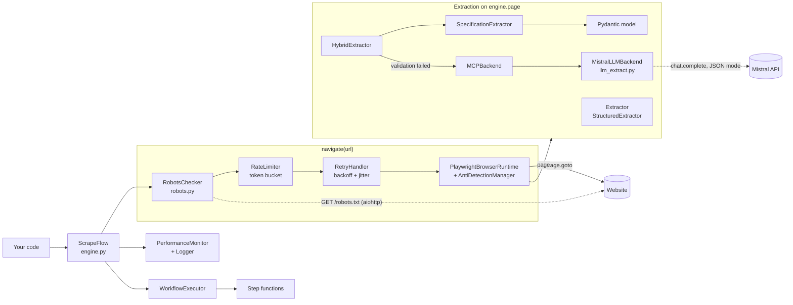

# ScrapeFlow

**A Playwright scraping engine that checks robots.txt, rate-limits and retries every navigation, and returns validated Pydantic objects instead of loose strings.**

[](https://pypi.org/project/scrapeflow-py/)
[](https://pypi.org/project/scrapeflow-py/)
[](https://pepy.tech/projects/scrapeflow-py)
[](https://github.com/irfanalidv/scrapeflow-py/actions/workflows/ci.yml)
[](https://github.com/irfanalidv/scrapeflow-py/actions/workflows/codeql.yml)
[](https://github.com/irfanalidv/scrapeflow-py/blob/main/LICENSE)
[](https://github.com/astral-sh/ruff)
[](https://mypy-lang.org/)
[](https://github.com/irfanalidv/scrapeflow-py/blob/main/CONTRIBUTING.md)

## Why

Raw Playwright scripts tend to grow the same plumbing every time: a retry loop, a sleep between
requests, a robots.txt check someone forgot, and a pile of `text_content()` calls whose `None`s
surface three steps later. ScrapeFlow puts that plumbing in one async engine. Every `navigate()`
checks robots.txt, waits for a rate-limit token and retries with backoff. Extraction is declared
once as selectors plus a Pydantic model, so bad data fails at the page that produced it. When a
redesign breaks your selectors, an optional LLM backend can fill in the fields instead.

## Features

| Area | What you get |
| --- | --- |
| Polite by default | robots.txt checked before every navigation ([RFC 9309](https://www.rfc-editor.org/rfc/rfc9309) failure rules), token-bucket rate limiting, `Crawl-delay` lookup |
| Resilience | Exponential backoff with jitter on navigation, clicks and form fills; `retryable` workflow steps re-run on transient errors; per-step timeouts |
| Spec-driven extraction | `FieldSpec` / `ItemSpec` selectors with fallback chains, attribute preference, URL resolution and defaults, validated by your Pydantic model |
| Hybrid extraction | `HybridExtractor` tries selectors first and calls an `MCPBackend` (built-in: Mistral) only when validation fails |
| LLM helpers | `generate_schema_from_prompt`, `extract_with_schema` (Mistral JSON mode, system prompt that tells the model to ignore instructions embedded in the page), HTML cleaning to cut tokens |
| Workflows | `Workflow` steps with conditions, required or optional steps, `on_success` / `on_error` callbacks, shared context |
| Sessions | Reusable `LoginHandler`s, `save_storage_state()` / `storage_state_path` to skip re-login |
| Reusable components | `SelectorRegistry` for versioned selectors, pagination handlers, login flows and schemas; `paginate()` with page, result and time limits |
| Observability | Request metrics (success rate, latency, errors by type, retries), failure-rate and consecutive-failure alert callbacks |
| Testable design | Every collaborator (runtime, rate limiter, retry handler, robots checker, logger, monitor) can be injected through protocol ports |
| Typed | Ships `py.typed`; checked with mypy |

## Install

```bash
pip install scrapeflow-py
# or
uv add scrapeflow-py

playwright install chromium              # download the browser Playwright drives
playwright install --with-deps chromium  # on a fresh Linux machine or container
```

Requires Python 3.10 to 3.13. The import name is `scrapeflow`. The Mistral SDK is a regular
dependency but is only called when you use the LLM features. A `Dockerfile` is included.

## Quickstart

Needs network access: it scrapes [books.toscrape.com](https://books.toscrape.com/), a site
built for scraping practice.

```python
import asyncio

from pydantic import BaseModel

from scrapeflow import ScrapeFlow, SpecificationExtractor
from scrapeflow.specifications import FieldSpec, ItemSpec


class Book(BaseModel):
    title: str
    price: str


class Catalogue(BaseModel):
    books: list[Book]


SCHEMA = {
    "books": ItemSpec(
        items_selector="article.product_pod",
        fields={
            "title": FieldSpec(selector="h3 a", prefer_attribute="title"),
            "price": ".price_color",
        },
    )
}


async def main() -> None:
    async with ScrapeFlow() as scraper:  # robots.txt check, rate limiting and retries are on
        await scraper.navigate("https://books.toscrape.com/")
        catalogue = await SpecificationExtractor(Catalogue, schema=SCHEMA).extract(scraper.page)
    for book in catalogue.books[:3]:
        print(book.price, book.title)


asyncio.run(main())
```

Output (the engine's log lines go to stderr):

```text
£51.77 A Light in the Attic
£53.74 Tipping the Velvet
£50.10 Soumission
```

If a required field is missing or has the wrong type, `extract()` raises
`ScrapeFlowValidationError` naming the model, instead of handing you a half-empty dict.

## How it works



Key design decisions:

- **Ports and adapters.** `ScrapeFlow` depends on the protocols in `ports.py`, not on concrete
  classes. Pass `runtime=`, `rate_limiter=`, `retry_handler=`, `robots_checker=`, `logger=` or
  `monitor=` to swap any piece; the test suite drives the engine with fakes this way.
- **Order inside `navigate()`.** robots.txt is checked once, before any request to the page. Rate
  limiting happens inside the retried function, so every retry also waits for a token.
- **Fail-closed robots.txt.** Following RFC 9309, a 4xx robots.txt means "no rules", while a 5xx or
  a network error means "disallow everything" until the cache entry (1 hour) expires.
- **Best-effort helpers, strict extraction.** `Extractor.extract_*` return `None` or `[]` when an
  element is missing (the cause is logged at DEBUG). Strictness lives in `SpecificationExtractor`:
  your Pydantic model decides what is required.
- **LLM only as a fallback.** `HybridExtractor` never calls the backend while selectors produce
  valid data, so pages that still match cost nothing extra.

More detail: [ARCHITECTURE.md](https://github.com/irfanalidv/scrapeflow-py/blob/main/ARCHITECTURE.md).

## Use cases and recipes

Every example runs offline against a small demo bookshop bundled in `examples/demo_site/` and
served on `127.0.0.1`. You need Chromium (`playwright install chromium`) but no internet and no
API key. CI runs all of them.

| Script | What it shows |
| --- | --- |
| [`price_monitor.py`](https://github.com/irfanalidv/scrapeflow-py/blob/main/examples/price_monitor.py) | Crawl a paginated catalogue with `paginate()` into validated records (price parsed to `float`), list the cheapest in-stock items, export CSV |
| [`polite_crawler.py`](https://github.com/irfanalidv/scrapeflow-py/blob/main/examples/polite_crawler.py) | robots.txt `Disallow` blocks a URL; `Crawl-delay` is read and turned into the rate limit; metrics at the end |
| [`resilient_workflow.py`](https://github.com/irfanalidv/scrapeflow-py/blob/main/examples/resilient_workflow.py) | Multi-step workflow: a transient failure retried, an optional step that fails without stopping the run, a conditional step, an HTML table parsed into dicts |
| [`login_session_reuse.py`](https://github.com/irfanalidv/scrapeflow-py/blob/main/examples/login_session_reuse.py) | Log in with a registered `LoginHandler`, save the session, then read members-only content in a fresh browser without logging in again |
| [`hybrid_llm_fallback.py`](https://github.com/irfanalidv/scrapeflow-py/blob/main/examples/hybrid_llm_fallback.py) | Selectors break after a "redesign"; `HybridExtractor` falls back to a backend (offline: a JSON-LD reader; `--live`: `MistralLLMBackend`) |

```bash
python examples/price_monitor.py
```

<details>
<summary>More snippets: workflows and alerts, LLM extraction</summary>

**Workflow with an alerting monitor.** Needs network access. Each step receives `page` and
`context`, and the engine is available as `context["scraper"]`.

```python
import asyncio

from scrapeflow import ScrapeFlow, Workflow
from scrapeflow.monitoring import PerformanceMonitor


async def open_listing(page, context):
    await context["scraper"].navigate("https://books.toscrape.com/")


async def count_books(page, context):
    return await context["scraper"].page.locator("article.product_pod").count()


async def main() -> None:
    workflow = (
        Workflow("books")
        .add_step("open", open_listing)
        .add_step("count", count_books, on_success=lambda n, ctx: print(n, "books"))
    )
    monitor = PerformanceMonitor(
        alert_on_consecutive_failures=3,
        alert_callback=lambda metrics, reason: print("ALERT:", reason),
    )
    async with ScrapeFlow(monitor=monitor) as scraper:
        result = await scraper.run_workflow(workflow)
        print(result.success, result.steps_completed)
        print(scraper.get_metrics().successful_requests, "successful requests")


asyncio.run(main())
```

```text
20 books
True ['open', 'count']
3 successful requests
```

**LLM extraction without selectors.** Needs `MISTRAL_API_KEY`. This fragment assumes `page_text`
holds page text and `scraper` is a started engine; see
[`hybrid_llm_fallback.py`](https://github.com/irfanalidv/scrapeflow-py/blob/main/examples/hybrid_llm_fallback.py)
for a complete script.

```python
from scrapeflow import create_mcp_backend, extract_with_schema, generate_schema_from_prompt


async def llm_extract(scraper, page_text: str) -> None:
    schema = generate_schema_from_prompt("book title and price")
    print(extract_with_schema(page_text, schema, prompt="Extract every book on the page"))

    backend = create_mcp_backend("mistral")
    fields = {"title": "Book title", "price": "Price with currency"}
    print(await backend.extract_with_semantics(scraper.page, fields))
```

</details>

## Configuration

Everything except the API key is configured in code through `ScrapeFlowConfig` and its parts.

| Environment variable | Used by |
| --- | --- |
| `MISTRAL_API_KEY` | `generate_schema_from_prompt`, `extract_with_schema(_async)`, `MistralLLMBackend`, and `HybridExtractor`'s default backend. Read from the environment, or from `.env` via python-dotenv. A missing key raises `ScrapeFlowConfigurationError`. |

<details>
<summary>All options and defaults</summary>

| Config | Field | Default | Meaning |
| --- | --- | --- | --- |
| `BrowserConfig` | `browser_type` | `CHROMIUM` | `CHROMIUM`, `FIREFOX` or `WEBKIT` |
| | `headless` | `True` | |
| | `timeout` | `30000` | Default timeout in ms (`0` means none) |
| | `slow_mo`, `args`, `proxy` | `0`, `[]`, `None` | Passed to Playwright `launch()` |
| | `storage_state_path` | `None` | Load cookies and localStorage from this file if it exists |
| `RetryConfig` | `max_retries` | `3` | Retries after the first attempt |
| | `initial_delay`, `max_delay` | `1.0`, `60.0` | Seconds; delay is `initial_delay * exponential_base ** attempt`, capped |
| | `exponential_base` | `2.0` | |
| | `jitter` | `True` | Adds up to 10% random delay |
| `RateLimitConfig` | `requests_per_second` | `1.0` | Token refill rate |
| | `requests_per_minute` | `None` | If both are set, the slower limit wins |
| | `burst_size` | `5` | Bucket capacity (requests allowed back to back) |
| `AntiDetectionConfig` | `stealth_mode` | `True` | Hide `navigator.webdriver` and similar automation hints |
| | `rotate_user_agents`, `user_agents` | `True`, built-in list | Random user agent per browser context |
| | `rotate_proxies`, `proxies` | `False`, `[]` | Round-robin proxy per launch |
| | `viewport_width`, `viewport_height` | `1920`, `1080` | |
| `EthicalCrawlingConfig` | `respect_robots_txt` | `True` | Check robots.txt in `navigate()` |
| | `user_agent_for_robots` | `"ScrapeFlow"` | Name matched against robots.txt `User-agent` groups |
| | `max_pages_per_domain`, `honor_noindex`, `data_retention_days`, `anonymize_ip`, `consent_required` | | Declarative policy fields stored with the config; ScrapeFlow does not enforce them yet |
| `PaginationConfig` | `max_pages`, `max_results`, `max_wait_time` | `100`, `None`, `None` | Limits for `paginate()` |
| `ScrapeFlowConfig` | `log_level`, `log_file` | `"INFO"`, `None` | Settings for the engine's `scrapeflow` logger |

</details>

## API overview

| Name | Kind | Purpose |
| --- | --- | --- |
| `ScrapeFlow` | class | Engine: `start` / `close` (or `async with`), `navigate`, `click`, `fill`, `wait_for_selector`, `screenshot`, `login`, `login_with_handler`, `save_storage_state`, `run_workflow`, `get_metrics` |
| `Workflow`, `Step` | classes | `add_step(name, func, ..., retryable, required, condition, on_success, on_error, timeout)` |
| `SpecificationExtractor` | class | Selectors (`FieldSpec`, `ItemSpec`) to a validated Pydantic model |
| `HybridExtractor` | class | Selector-first extraction with `MCPBackend` fallback |
| `Extractor`, `StructuredExtractor` | classes | Best-effort helpers (text, attributes, HTML, JSON and JSON-LD, tables, links, images) and dict-schema extraction |
| `MCPBackend`, `MistralLLMBackend`, `PlaceholderMCPBackend`, `create_mcp_backend` | classes, factory | Pluggable semantic extraction backends |
| `generate_schema_from_prompt`, `extract_with_schema`, `extract_with_schema_async` | functions | Mistral-powered schema generation and extraction |
| `RobotsChecker` | class | `can_fetch(url)` and `get_crawl_delay(url)` with per-origin caching |
| `SelectorRegistry`, `get_registry`, `LoginHandler` | classes, function | Shared selectors, schemas, pagination and login components |
| `paginate` | async generator | `scrapeflow.pagination.paginate(engine, url, handler, extract_func, config)` |
| `ProductPriceSpec`, `JobListingSpec`, `TariffCodeSpec` | Pydantic models | Ready-made specs for common record types |
| `ScrapeFlowError` and subclasses | exceptions | `ScrapeFlowRetryError`, `ScrapeFlowTimeoutError`, `ScrapeFlowBlockedError`, `ScrapeFlowValidationError`, `ScrapeFlowRobotsDisallowedError`, `ScrapeFlowNotStartedError`, `ScrapeFlowConfigurationError` |

## Standards

- **robots.txt:** M. Koster, G. Illyes, H. Zeller and L. Sassman. *Robots Exclusion Protocol.*
  [RFC 9309](https://www.rfc-editor.org/rfc/rfc9309), IETF, September 2022. Rules are parsed with
  Python's `urllib.robotparser`, and fetch failures follow section 2.3.1. `Crawl-delay` is not part
  of the RFC; ScrapeFlow reads it but does not apply it automatically.

## When to use it

- **ScrapeFlow** fits when pages need a real browser (JavaScript rendering, logins, clicks) and you
  want retries, pacing, robots.txt and validated output without writing that plumbing yourself.
- **Plain Playwright** is enough for a one-off script where none of that matters.
- **An HTTP crawler such as Scrapy** is the better tool for large crawls of static HTML. It costs far
  less per page than driving a browser, and it has scheduling, deduplication and export pipelines
  that ScrapeFlow does not try to replicate.

## Responsible use

ScrapeFlow respects robots.txt by default and rate-limits every navigation. Keep it that way. You
are responsible for complying with each site's terms of service, its robots.txt, and applicable law,
including data-protection rules such as GDPR and CCPA when pages contain personal data. The
anti-detection options exist so that sites do not serve broken pages to headless browsers. They are
not a licence to get around access controls, paywalls or explicit bans. Prefer an official API when
one exists.

## Roadmap

- Apply `Crawl-delay` automatically when `respect_robots_txt` is on.
- Enforce `max_pages_per_domain` and `honor_noindex` from `EthicalCrawlingConfig`.
- Real adapters for the `scrapy_mcp` and `playwright_mcp` backend names (today they warn and fall
  back to the placeholder backend).
- An optional OpenAI-compatible backend for `llm_extract`.

## Contributing, security, citation, license

- Contributions are welcome. See [CONTRIBUTING.md](https://github.com/irfanalidv/scrapeflow-py/blob/main/CONTRIBUTING.md)
  and the [Code of Conduct](https://github.com/irfanalidv/scrapeflow-py/blob/main/CODE_OF_CONDUCT.md).
  The dev loop is `pip install -e ".[dev]" && playwright install chromium`, then
  `ruff check . && ruff format --check . && mypy scrapeflow && pytest --cov=scrapeflow`.
- Report vulnerabilities as described in [SECURITY.md](https://github.com/irfanalidv/scrapeflow-py/blob/main/SECURITY.md).
- To cite ScrapeFlow, use [CITATION.cff](https://github.com/irfanalidv/scrapeflow-py/blob/main/CITATION.cff).
- Release notes are in [CHANGELOG.md](https://github.com/irfanalidv/scrapeflow-py/blob/main/CHANGELOG.md).
- MIT licensed. See [LICENSE](https://github.com/irfanalidv/scrapeflow-py/blob/main/LICENSE).
